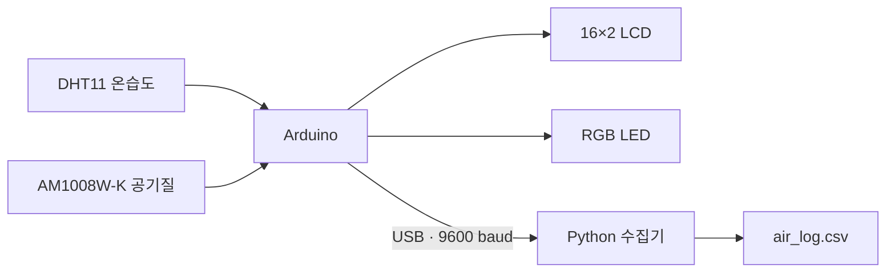

# Indoor Air Monitor Project · LEVEL 1 - Beginner

[LEVEL 1 - Beginner](%EB%A0%88%EB%B2%A81.md) · [LEVEL 2 - Explorer](%EB%A0%88%EB%B2%A82.md) · [LEVEL 3 - Practitioner](%EB%A0%88%EB%B2%A83.md) · [LEVEL 4 - Advanced](%EB%A0%88%EB%B2%A84.md) · [LEVEL 5 - Expert](%EB%A0%88%EB%B2%A85.md)

[같은 수준의 프로필](https://github.com/PUVKID/PUVKID/blob/main/docs/읽기안내/레벨1.md) · [프로젝트 첫 화면](../../README.md)

## LEVEL 1 · 프로젝트 소개와 읽는 방법

실내 센서가 읽은 값을 문자 화면과 불빛으로 보고 PC에 남기는 프로젝트입니다. 예를 들어 불빛이 바뀌더라도 숫자 기록과 어떤 센서가 읽기에 성공했는지를 함께 봐야 합니다. **센서 측정·화면 표시·PC 기록은 서로 연결된 별도 단계**입니다.

## LEVEL 1 · 실제 기능과 동작 범위

| 확인할 항목 (Checklist) | 본문의 핵심 조건 |
| --- | --- |
| 기능·동작 | 온습도·CO₂·VOC·PM2.5 같은 값을 읽고 LCD 세 화면을 돌아가며 표시합니다. LED는 읽기에 성공한 항목 가운데 가장 높은 등급을 표시하고 전부 실패하면 꺼집니다. 빈칸은 실제로 0을 측정했다는 뜻이 아닙니다. |
| 입력·처리·출력 | 센서는 숫자를 보드에 보내고 보드는 화면·불빛·시리얼로 내보냅니다. PC는 도착한 행에 시각을 붙여 파일로 저장합니다. 이 시각은 PC가 받았을 때의 시간입니다. |
| 결과·한계 | 파일의 빈칸은 센서 일부가 실패했을 수 있다는 표시입니다. LED가 꺼져 있으면 모든 읽기가 실패했는지도 봅니다. 예시 파일이 있다고 해서 지금 이 방에서 같은 수치를 측정한 것은 아닙니다. |


온습도·CO₂·VOC·PM2.5 같은 값을 읽고 LCD 세 화면을 돌아가며 표시합니다. LED는 읽기에 성공한 항목 가운데 가장 높은 등급을 표시하고 전부 실패하면 꺼집니다. 빈칸은 실제로 0을 측정했다는 뜻이 아닙니다.

사용자가 보는 동작을 먼저 설명하고 아래 실제 기능표의 이름과 연결합니다.

**기능별 공통 근거**

센서로 읽은 실내 환경을 화면과 불빛으로 확인하고 PC에 기록하는 프로젝트입니다.

DHT11과 AM1008W-K의 측정값을 아두이노에서 읽어 실내 환경을 확인하는 프로젝트입니다. 16×2 LCD는 세 화면을 순환하며 값을 표시하고, RGB LED는 읽기에 성공한 항목 중 가장 높은 위험 등급을 색으로 보여줍니다. PC에서는 Python 프로그램이 시리얼 데이터를 받아 수신 시각과 함께 CSV에 저장합니다.

### 프로젝트 연계와 담당 범위

이 코드는 [ICT-IndoorAD 실내 환경 프로젝트](https://github.com/ICT-IndoorAD)에 참여하면서 **곽윤석(Kwak Yunsuk)이 직접 작성한 담당 부분**을 정리한 것입니다. 아두이노 센서 측정·LCD·RGB LED 제어와 Python 시리얼·CSV 기록 코드를 차수별로 담았습니다.

- [ICT-IndoorAD 프로젝트 전체](https://github.com/ICT-IndoorAD): 함께 진행한 프로젝트와 참여자별 저장소를 확인할 수 있습니다.
- [ICT-IndoorAD 개인 담당 저장소](https://github.com/ICT-IndoorAD/Yunsuk-Kwak): 프로젝트 안에서 작성한 개인 담당 코드의 연결 경로입니다.

이 저장소의 설명과 구현 범위는 위 개인 담당 코드에 한정합니다. 공동 프로젝트의 다른 참여자가 작성한 부분은 각 참여자의 저장소에서 확인해 주세요.

| 기능 | 동작 |
| --- | --- |
| 온습도 측정 | DHT11과 AM1008W-K에서 각각 온도·습도 수집 |
| 공기질 측정 | AM1008W-K의 CO₂, VOC 단계, PM2.5 수집 |
| LCD 표시 | DHT → AM 온습도 → 공기질 화면을 약 3초마다 전환 |
| LED 표시 | 좋음·보통·나쁨·매우 나쁨을 색으로 구분 |
| 데이터 기록 | 약 1초 간격의 시리얼 데이터를 CSV에 누적 저장 |
| 오류 처리 | 실패한 센서 항목은 빈칸으로 전송, 모든 값이 빈 행은 저장 제외 |



## LEVEL 1 · 입력에서 처리와 출력까지

센서는 숫자를 보드에 보내고 보드는 화면·불빛·시리얼로 내보냅니다. PC는 도착한 행에 시각을 붙여 파일로 저장합니다. 이 시각은 PC가 받았을 때의 시간입니다.

| 단계 | 이 프로젝트에서 다루는 내용 |
| --- | --- |
| 입력 | DHT11·AM1008W-K 측정값 |
| 처리 | Arduino I²C 센싱·LCD·LED, UART 수신 검사 |
| 출력 | 측정 화면·RGB 표시·타임스탬프 CSV |


---

## LEVEL 1 · 사용·실험 순서와 확인 방법

차수별 배선·보드와 필요한 라이브러리를 준비하고 스케치를 업로드합니다. 시리얼 출력이 보이는지 확인한 뒤 모니터를 닫고 PC 수집기를 시작합니다. 새 기록 파일을 정하고 끝낼 때 Ctrl+C를 사용합니다.

## LEVEL 1 · 결과와 한계를 해석하는 기준

파일의 빈칸은 센서 일부가 실패했을 수 있다는 표시입니다. LED가 꺼져 있으면 모든 읽기가 실패했는지도 봅니다. 예시 파일이 있다고 해서 지금 이 방에서 같은 수치를 측정한 것은 아닙니다.

## LEVEL 1 · 구현과 핵심 파일을 연결해 읽기

Arduino 코드는 센서와 화면·불빛을 다루고 pc_csv_logger.py는 PC 기록을 담당합니다. 코드를 처음 읽으면 입력·출력 표와 배선, 다음으로 수집기의 필드·파일 설정을 확인합니다.

## LEVEL 1 · 용어와 실수하기 쉬운 구분

Arduino는 센서와 화면을 연결해 프로그램을 실행하는 작은 제어 보드입니다. DHT11·AM1008W-K는 측정 센서 이름입니다. LCD는 문자 표시창이고 RGB LED는 여러 색으로 상태를 표시하는 불빛입니다. I²C는 보드와 센서가 주소로 구분해 통신하는 방식, UART·시리얼은 PC로 글자 데이터를 보내는 통신입니다. CSV는 쉼표로 열을 나눈 텍스트 표입니다.

**실제 배선·보드·센서·포트와 라이브러리가 필요합니다.** PC 수신 시각은 센서 자체의 측정 시각이 아니고 예시 CSV를 새 공간의 실측 결과로 읽지 않습니다. 일부 센서 실패는 빈칸으로 남기며 자동 포트 재연결은 구현되어 있지 않습니다.

## LEVEL 1 · DMF 적용 자료

| 입력 | 처리와 확인 | 한계 |
| --- | --- | --- |
| 기존 센서 코드·측정 CSV | 원본 해시·버전·제한 조건·감사 이력 | 외부 DMF 필요, 새 측정 아님 |

DMF는 자료가 바뀌었는지 확인하고 변경 이력을 살피는 데 쓰는 도구입니다. 기존 측정 CSV와 코드를 입력으로 삼아 원본의 지문인 해시와 버전·감사 이력을 확인합니다. 자료가 달라지거나 필수 준비물이 없으면 오류를 살펴야 하며, 새로 공기를 측정한 결과는 아닙니다. [이 수준의 DMF 적용 1차 설명](../revisions/dmf-1.md#reading-level-1)에서 조건과 확인 범위를 읽습니다.

## LEVEL 1 · 전체 차수와 같은 수준의 상세 설명

차수 이름은 실제 보관 단위를 따릅니다. 부분본·시험 도구·최종 안내는 제품 버전과 구분하며, 폴더와 직전 비교를 함께 연결합니다.

| 차수·자료 | 자료 |
| --- | --- |
| 1차 | **자료 폴더** [자료](../../%EC%BD%94%EB%93%9C/1%EC%B0%A8)<br>**이 수준의 차수 설명** [LEVEL 1 - Beginner](../revisions/step-1.md#reading-level-1)<br>**직전 비교·범위** [전체 비교](../revisions/step-1.patch) |
| 최종 | **자료 폴더** [자료](../../%EC%BD%94%EB%93%9C/%EC%B5%9C%EC%A2%85)<br>**이 수준의 차수 설명** [LEVEL 1 - Beginner](../revisions/step-2.md#reading-level-1)<br>**직전 비교·범위** [전체 비교](../revisions/step-2.patch) |
| DMF 적용 1차 | **자료 폴더** [자료](../../DMF%20적용/1차) · **이 수준의 설명** [LEVEL 1](../revisions/dmf-1.md#reading-level-1) · **비교** [전체 비교](../revisions/dmf-1.patch) |
| DMF 적용 최종 | 1차 납품 묶음 · [자료](../../DMF%20적용/최종) · [LEVEL 1](../revisions/dmf-1.md#reading-level-1) · [전체 비교](../revisions/dmf-1.patch) |

## LEVEL 1 · 논문·원고와 원본 자료의 범위

공개 구성은 센서·화면·수집 코드와 기존 측정 자료입니다. 논문 성능이나 새로운 공간의 실측 결과를 만들지 않습니다. 원본 CSV의 기간·필드·누락 조건은 해당 차수 설명과 아래 전체 근거에서 확인합니다.

## LEVEL 1 · 원래 모든 세부 설명으로 이동하기

설정값·코드 예제·실패 조건·측정 범위·화면과 파일별 안내를 생략하지 않도록 첫 화면의 전체 본문을 아래에 함께 둡니다. 각 항목은 이 페이지의 공통 근거로 바로 이동합니다. 원문에 담긴 이전 차수 조건을 현재 실행 조건으로 자동 적용하지 않습니다.

| 첫 화면의 원래 항목 | 이 페이지의 전체 근거 |
| --- | --- |
| Indoor Air Monitor Project | [원문 보기](#source-section-1) |
| 센서 프레임에서 CSV 한 행까지 | [원문 보기](#source-section-2) |
| 차수와 자료 둘러보기 | [원문 보기](#source-section-3) |
| 제가 구현한 부분 | [원문 보기](#source-section-4) |
| 주요 개발 내용 | [원문 보기](#source-section-5) |
| 입력·처리·출력 | [원문 보기](#source-section-6) |
| 프로젝트 소개 | [원문 보기](#source-section-7) |
| 프로젝트 연계와 담당 범위 | [원문 보기](#source-section-8) |
| 저장소 구성 | [원문 보기](#source-section-9) |
| 하드웨어 연결 | [원문 보기](#source-section-10) |
| 빠른 시작 | [원문 보기](#source-section-11) |
| 1. 아두이노에 스케치 업로드 | [원문 보기](#source-section-12) |
| 2. Python 환경 준비 | [원문 보기](#source-section-13) |
| 3. 포트 설정 및 기록 시작 | [원문 보기](#source-section-14) |
| 데이터 구성 | [원문 보기](#source-section-15) |
| LED 표시 기준 | [원문 보기](#source-section-16) |
| 문제 해결 | [원문 보기](#source-section-17) |
| 측정 원본과 프로젝트 문서 | [원문 보기](#source-section-18) |

## LEVEL 1 · 항목별 자세한 풀이와 확인 지점

### LEVEL 1 · 센서 프레임에서 CSV 한 행까지

이 항목은 다음 실제 조건으로 동작합니다. 용어는 앞선 설명과 연결하고 값·입력·출력이 무엇을 가리키는지 함께 읽습니다.

Arduino는 DHT11과 AM1008W-K를 읽어 LCD·RGB LED·시리얼로 출력하고, PC의 `pc_csv_logger.py`는 수신 시각을 붙여 저장합니다.

1차는 온도와 습도 2개 값, 최종은 DHT 온습도·AM 온습도·CO₂·VOC·PM2.5의 7개 측정값을 다룹니다. 최종 CSV는 timestamp를 앞에 붙인 8열이며 air_log.csv로 분리해 저장합니다.

최종 `readAM1008W`는 주소 0x28의 25바이트 응답에서 헤더 0x16·길이·XOR 체크섬을 확인합니다. LCD 0x27·16×2와 같은 I²C 버스를 사용하고 DHT는 2번 핀, RGB는 9/10/11번입니다. 화면은 DHT→AM온습도→공기질을 3초씩 순환하고 16칸 공백 채움으로 잔상을 지웁니다. 읽기에 성공한 센서 중 가장 높은 등급을 LED에 표시하며 전부 실패하면 끕니다.

수신 검사: PC `parse_line`은 쉼표 7필드·숫자/빈칸·최소 한 개 값이라는 조건을 적용합니다. 헤더·깨진 열 수·모두 빈 행은 저장하지 않고 일부 실패는 빈칸으로 남깁니다.

연결과 저장: 기본 COM4·9600 baud·2초 timeout으로 열고 2초 대기와 버퍼 초기화 뒤 기록합니다. UTF-8 추가 모드에서 빈 파일일 때만 헤더를 만들고 매 행 flush합니다.

종료와 제약: Ctrl+C 뒤 finally에서 포트를 닫으며 자동 포트 재연결은 구현되어 있지 않습니다.

준비할 때 센서 배선·보드·DHT/LCD 라이브러리·pyserial·실제 PORT를 확인하고 시리얼 모니터와 PC 수집기가 같은 포트를 동시에 점유하지 않게 합니다. 새 측정의 OUTPUT_FILE을 분리하면 이전 기록을 보존할 수 있습니다. PC 시각은 센서 자체 시각이 아니며, 저장된 예시 CSV를 새 공간의 측정 결과로 해석하지 않습니다. 등급별 경계값과 오류 처리 함수는 최종 차수 설명에 모두 연결했습니다.

센서가 읽은 값이 보드에서 화면·불빛·글자로 전달되고 PC가 표의 한 행으로 남깁니다. 센서 일부가 실패해 빈칸이 생기는 것과 실제0측정은 다릅니다.

[이 항목의 전체 조건·원문](#source-section-2)

### LEVEL 1 · 차수와 자료 둘러보기

1차는 온습도 두 값이고 최종은 센서와 기록 필드를 확장한 구성입니다. 번호가 없는 단계를 새 차수로 만들지 않습니다.

[이 항목의 전체 조건·원문](#source-section-3)

### LEVEL 1 · 제가 구현한 부분

이 항목은 다음 실제 조건으로 동작합니다. 용어는 앞선 설명과 연결하고 값·입력·출력이 무엇을 가리키는지 함께 읽습니다.

DHT11·AM1008W-K 센서 수집, LCD·RGB LED 표시, Arduino 시리얼 출력과 Python CSV 수집기를 작성했습니다. 이 저장소에는 제가 구현한 센서·기록 코드와 측정 자료를 정리합니다.

센서를 읽고 화면과 불빛으로 보여 주는 보드 코드, PC에서 기록하는 코드를 작성한 범위입니다. 다른 연구나 장치 전체를 개발했다고 확장하지 않습니다.

[이 항목의 전체 조건·원문](#source-section-4)

### LEVEL 1 · 주요 개발 내용

이 항목은 다음 실제 조건으로 동작합니다. 용어는 앞선 설명과 연결하고 값·입력·출력이 무엇을 가리키는지 함께 읽습니다.

AM1008W-K를 더해 일곱 센서 값과 세 LCD 화면·종합 RGB 등급을 구성합니다.

최종 수집기는 형식 검사와 시간 기록을 포함합니다. 센서·배선과 라이브러리를 준비한 뒤 실행합니다.

DHT에 AM1008W 온습도·CO₂·VOC·PM2.5를 추가하여 LCD 순환 표시와 센서별 위험 등급을 종합합니다.

parse_line이 일곱 필드의 숫자 또는 빈칸 여부를 검사합니다. 일부 센서 실패는 빈칸으로 남기고 전부 빈 행은 제외합니다.

포트 기본값은 COM4로 바뀌고 air_log.csv를 UTF-8로 저장합니다. PC 수신 시각을 앞에 붙여 총 여덟 열을 기록합니다.

**자료별 안내:** [1차](../versions/first.md) · [최종](../versions/latest.md) · [전체 기록](../VERSIONS.md)

AM센서를 더해 측정값·화면·등급·파일 형식을 확장했습니다. 정상값이 일부라도 있으면 실패항목은 빈칸으로 남길 수 있습니다.

[이 항목의 전체 조건·원문](#source-section-5)

### LEVEL 1 · 입력·처리·출력

이 항목은 다음 실제 조건으로 동작합니다. 용어는 앞선 설명과 연결하고 값·입력·출력이 무엇을 가리키는지 함께 읽습니다.

입력 — DHT11·AM1008W-K 측정값

처리 — Arduino I²C 센싱·LCD·LED, UART 수신 검사

출력 — 측정 화면·RGB 표시·타임스탬프 CSV

--

센서값이 들어오고 보드에서 화면·불빛·통신으로 나가며 PC에 파일로 남습니다.

[이 항목의 전체 조건·원문](#source-section-6)

### LEVEL 1 · 프로젝트 소개

이 항목은 다음 실제 조건으로 동작합니다. 용어는 앞선 설명과 연결하고 값·입력·출력이 무엇을 가리키는지 함께 읽습니다.

센서로 읽은 실내 환경을 화면과 불빛으로 확인하고 PC에 기록하는 프로젝트입니다.

DHT11과 AM1008W-K의 측정값을 아두이노에서 읽어 실내 환경을 확인하는 프로젝트입니다. 16×2 LCD는 세 화면을 순환하며 값을 표시하고, RGB LED는 읽기에 성공한 항목 중 가장 높은 위험 등급을 색으로 보여줍니다. PC에서는 Python 프로그램이 시리얼 데이터를 받아 수신 시각과 함께 CSV에 저장합니다.

이 코드는 [ICT-IndoorAD 실내 환경 프로젝트](https://github.com/ICT-IndoorAD)에 참여하면서 **곽윤석(Kwak Yunsuk)이 직접 작성한 담당 부분**을 정리한 것입니다. 아두이노 센서 측정·LCD·RGB LED 제어와 Python 시리얼·CSV 기록 코드를 차수별로 담았습니다.

[ICT-IndoorAD 프로젝트 전체](https://github.com/ICT-IndoorAD): 함께 진행한 프로젝트와 참여자별 저장소를 확인할 수 있습니다.

[ICT-IndoorAD 개인 담당 저장소](https://github.com/ICT-IndoorAD/Yunsuk-Kwak): 프로젝트 안에서 작성한 개인 담당 코드의 연결 경로입니다.

이 저장소의 설명과 구현 범위는 위 개인 담당 코드에 한정합니다. 공동 프로젝트의 다른 참여자가 작성한 부분은 각 참여자의 저장소에서 확인해 주세요.

온습도 측정 — DHT11과 AM1008W-K에서 각각 온도·습도 수집

공기질 측정 — AM1008W-K의 CO₂, VOC 단계, PM2.5 수집

LCD 표시 — DHT → AM 온습도 → 공기질 화면을 약 3초마다 전환

LED 표시 — 좋음·보통·나쁨·매우 나쁨을 색으로 구분

데이터 기록 — 약 1초 간격의 시리얼 데이터를 CSV에 누적 저장

오류 처리 — 실패한 센서 항목은 빈칸으로 전송, 모든 값이 빈 행은 저장 제외

실내 상태를 숫자와 불빛으로 확인하고 나중에 읽을 기록을 남기는 도구입니다.

[이 항목의 전체 조건·원문](#source-section-7)

### LEVEL 1 · 프로젝트 연계와 담당 범위

관련 프로젝트와 연결되는 배경을 설명하는 항목입니다. 이 저장소에 실제 포함된 센서·기록 구현의 범위를 먼저 확인합니다.

[이 항목의 전체 조건·원문](#source-section-8)

### LEVEL 1 · 저장소 구성

이 항목은 다음 실제 조건으로 동작합니다. 용어는 앞선 설명과 연결하고 값·입력·출력이 무엇을 가리키는지 함께 읽습니다.

초기 온습도 실험과 공기질 센서를 추가한 최종 코드를 함께 보관합니다. 주요 경로는 다음과 같습니다.

[아두이노 스케치](../../%EC%BD%94%EB%93%9C/%EC%B5%9C%EC%A2%85/%EC%95%84%EB%91%90%EC%9D%B4%EB%85%B8%20%EC%BD%94%EB%93%9C/dht_am1008w_lcd_csv/dht_am1008w_lcd_csv.ino): 센서 읽기, LCD 표시, LED 등급 판정, CSV 전송.

[Python 수집기](../../%EC%BD%94%EB%93%9C/%EC%B5%9C%EC%A2%85/CSV%20%ED%8C%8C%EC%9D%B4%EC%8D%AC%20%EC%BD%94%EB%93%9C/pc_csv_logger.py): 데이터 형식 검사 및 타임스탬프를 포함한 CSV 저장.

1차 `dht_log.csv`와 최종 `air_log.csv`를 전체 원문으로 보관합니다. [측정 기록의 행·열·시각](../DATA.md)을 확인할 수 있습니다. 새 측정은 기존 파일과 다른 이름으로 기록하세요.

Arduino 스케치와 PC 수집기,기존CSV가 서로 다른 종류의 파일입니다.

[이 항목의 전체 조건·원문](#source-section-9)

### LEVEL 1 · 하드웨어 연결

이 항목은 다음 실제 조건으로 동작합니다. 용어는 앞선 설명과 연결하고 값·입력·출력이 무엇을 가리키는지 함께 읽습니다.

센서를 연결하기 전에 보드 종류를 확인하세요. 아래 핀은 현재 스케치 설정이며 A4/A5는 Arduino Uno 계열 기준입니다. 다른 보드에서는 해당 보드의 SDA/SCL 핀을 사용하세요.

DHT11 — 데이터 핀 D2, 코드의 `DHTTYPE = DHT11`

AM1008W-K — I²C 버전, SDA → A4 / SCL → A5, 주소 `0x28`

16×2 I²C LCD — SDA → A4 / SCL → A5, 주소 `0x27`

RGB LED — R → D9 / G → D10 / B → D11

PC 연결 — USB 시리얼, `9600 baud`

AM1008W-K와 LCD는 같은 I²C 버스를 공유합니다. 전원 전압은 각 부품 사양에 맞추고 GND를 공통으로 연결하세요. LED에는 적절한 전류 제한 저항을 사용하세요. 현재 LED 제어는 HIGH에서 켜지는 방식이므로 공통 애노드 LED는 제어 논리를 반전해야 합니다.

센서·LCD·LED 선을 실제 보드에 맞게 연결해야 합니다. PC프로그램만으로 배선이 준비되지는 않습니다.

[이 항목의 전체 조건·원문](#source-section-10)

### LEVEL 1 · 빠른 시작

이 항목은 다음 실제 조건으로 동작합니다. 용어는 앞선 설명과 연결하고 값·입력·출력이 무엇을 가리키는지 함께 읽습니다.

Arduino IDE에서 `코드/최종/아두이노 코드/dht_am1008w_lcd_csv/dht_am1008w_lcd_csv.ino`를 엽니다.

`DHT sensor library`와 해당 라이브러리가 요구하는 의존성, `LiquidCrystal_I2C` 라이브러리를 설치합니다. LCD 라이브러리는 `init()`와 `backlight()`를 지원하는 버전을 사용하세요.

보드와 포트를 선택한 뒤 업로드합니다.

시리얼 모니터를 `9600 baud`로 열어 CSV 출력 여부를 확인하고, Python 실행 전에는 시리얼 모니터를 닫습니다.

DHT22를 사용하면 `DHTTYPE`을 `DHT22`로 바꾸세요. LCD 주소가 다르면 `LiquidCrystal_I2C lcd(0x27, 16, 2)`의 주소를 실제 장치 주소로 수정하세요.

저장소 최상위 폴더에서 실행합니다.

`pc_csv_logger.py`의 `PORT`를 실제 아두이노 포트로 바꿉니다. 기본값은 `COM4`입니다.

`Ctrl+C`로 종료합니다. 파일은 현재 작업 폴더에 생성되며, 기존 파일이 있으면 이어서 저장합니다. 기존 측정과 새 기록을 분리하려면 실행 전에 `OUTPUT_FILE`을 다른 이름으로 지정하세요.

보드업로드·출력확인 후 PC기록을 시작합니다. 같은 포트를 두 프로그램이 함께 사용하지 않습니다.

[이 항목의 전체 조건·원문](#source-section-11)

### LEVEL 1 · 1. 아두이노에 스케치 업로드

선택한 차수의 보드프로그램을 먼저 올려야 센서값이 나옵니다.

[이 항목의 전체 조건·원문](#source-section-12)

### LEVEL 1 · 2. Python 환경 준비

PC쪽 기록프로그램에 필요한 Python과 pyserial을 준비합니다.

[이 항목의 전체 조건·원문](#source-section-13)

### LEVEL 1 · 3. 포트 설정 및 기록 시작

COM포트와 새 기록파일 이름을 실제 장치에 맞춥니다. 기존기록을 구분해 보존합니다.

[이 항목의 전체 조건·원문](#source-section-14)

### LEVEL 1 · 데이터 구성

이 항목은 다음 실제 조건으로 동작합니다. 용어는 앞선 설명과 연결하고 값·입력·출력이 무엇을 가리키는지 함께 읽습니다.

CSV는 PC 수신 시각과 센서 값 7개로 구성됩니다. `timestamp`는 PC의 로컬 시각이며 시간대 정보는 포함하지 않습니다.

`timestamp` · PC에서 데이터를 수신한 시각 · `YYYY-MM-DD HH:MM:SS`

`dht_temp_C` · DHT 온도 · °C

`dht_humi_pct` · DHT 상대습도 · %

`am_temp_C` · AM1008W-K 온도 · °C

`am_humi_pct` · AM1008W-K 상대습도 · %

`co2_ppm` · CO₂ · ppm

`voc_level` · VOC 단계 · 센서 단계 값

`pm25_ugm3` · PM2.5 · µg/m³

수집기는 헤더, 열 개수가 잘못된 행, 숫자 또는 빈칸 이외의 값이 있는 행을 건너뜁니다. 일부 센서가 실패한 행은 정상 항목을 보존합니다. 측정 날짜·행 수·연속성은 직접 수집한 파일을 기준으로 확인하세요.

한 행은 수신시각과 센서값입니다. 빈칸과0,PC 시각과센서 시각을 구분합니다.

[이 항목의 전체 조건·원문](#source-section-15)

### LEVEL 1 · LED 표시 기준

이 항목은 다음 실제 조건으로 동작합니다. 용어는 앞선 설명과 연결하고 값·입력·출력이 무엇을 가리키는지 함께 읽습니다.

현재 코드에 구현된 프로젝트 판정 기준입니다. 각 항목을 평가한 뒤 가장 나쁜 등급을 최종 색으로 표시합니다. 아래 범위는 서로 겹치지 않도록 코드의 판정 순서를 반영했습니다.

온도 (°C) · 20 이상 26 미만 · 18 이상 20 미만 / 26 이상 28 미만 · 15 이상 18 미만 / 28 이상 30 미만 · 15 미만 / 30 이상

습도 (%) · 40–60 · 30 이상 40 미만 / 60 초과 70 이하 · 20 이상 30 미만 / 70 초과 80 이하 · 20 미만 / 80 초과

CO₂ (ppm) · 800 미만 · 800 이상 1000 미만 · 1000 이상 1500 미만 · 1500 이상

VOC 단계 · 0–1 · 2 · 3 이상 · 해당 없음

PM2.5 (µg/m³) · 15 이하 · 15 초과 35 이하 · 35 초과 75 이하 · 75 초과

모든 센서 읽기가 실패하면 LED는 꺼집니다. 이 표는 코드 동작을 설명하며 공식 환경·건강 판정 기준을 제시하는 표가 아닙니다.

여러 값 중 읽기에 성공한 항목의 가장 높은 등급을 불빛으로 보입니다. 모두 읽지 못하면 불빛을 끕니다.

[이 항목의 전체 조건·원문](#source-section-16)

### LEVEL 1 · 문제 해결

이 항목은 다음 실제 조건으로 동작합니다. 용어는 앞선 설명과 연결하고 값·입력·출력이 무엇을 가리키는지 함께 읽습니다.

시리얼 포트를 열 수 없음 — `PORT` 설정, USB 연결, 다른 프로그램의 포트 사용 여부

LCD에 글자가 나오지 않음 — I²C 주소, SDA/SCL 연결, 대비 조절

`AM1008W Error` 표시 — I²C 버전 여부, 주소 `0x28`, 배선·전원, 프레임 및 체크섬

`DHT Sensor Error` 표시 — 데이터 핀 D2, 센서 종류, 배선

CSV에 일부 값이 빈칸 — 해당 센서 읽기 실패 여부

LED 색상이 예상과 다름 — 모든 측정 항목 중 가장 나쁜 등급, LED 종류 및 배선

--

**측정 → 표시 → 기록**<br>

실내 환경 센싱 프로젝트

값이 안보이면 배선·주소·포트·라이브러리를 나누어 확인합니다.

[이 항목의 전체 조건·원문](#source-section-17)

### LEVEL 1 · 측정 원본과 프로젝트 문서

이 항목은 다음 실제 조건으로 동작합니다. 용어는 앞선 설명과 연결하고 값·입력·출력이 무엇을 가리키는지 함께 읽습니다.

1차 측정 — [dht_log.csv](../../%EC%BD%94%EB%93%9C/1%EC%B0%A8/dht_log.csv)

최종 측정 — [air_log.csv](../../%EC%BD%94%EB%93%9C/%EC%B5%9C%EC%A2%85/CSV%20%ED%8C%8C%EC%9D%B4%EC%8D%AC%20%EC%BD%94%EB%93%9C/air_log.csv)

CSV는 저장된 전체 기록입니다. 파일의 처음과 마지막 시각 사이가 중단 없는 연속 측정을 뜻하지는 않습니다. 큰 CSV는 내려받아 확인합니다.

기존에 측정한 CSV와 프로젝트 설명을 보관합니다. 새 방에서 새로 측정한 결과로 바꾸어 읽지 않습니다.

[이 항목의 전체 조건·원문](#source-section-18)


## LEVEL 1 · 다음에 읽을 곳

같은 관점의 [프로필](https://github.com/PUVKID/PUVKID/blob/main/docs/읽기안내/레벨1.md)에서 다른 프로젝트로 이동하거나 위 차수표에서 구현의 변화를 읽습니다. 다른 깊이가 필요하면 페이지 위의 수준 선택을 이용합니다. 수치·예제 명령·비교 파일은 아래 전체 근거와 차수별 원문에서 함께 확인합니다.

<a id="common-source"></a>
## LEVEL 1 · 공통 근거 · 첫 화면의 원래 전체 설명


<a name="-indoor-air-monitor-project"></a>
<a id="source-section-1"></a>
## Indoor Air Monitor Project

Arduino 기반 실내 공기질 측정과 PC 기록 프로젝트입니다.

**기술 분류:** 임베디드·IoT › 센서 통신 › I²C·UART·표시·CSV

`Arduino`
`Python`
`CSV`
`PBL`

[빠른 시작](#quick-start) · [하드웨어 연결](#hardware) · [데이터 구성](#data-settings)

[핵심 구성](#input-processing-output)

<a name="implementation-details"></a>

<a name="-센서-프레임에서-csv-한-행까지"></a>
<a id="source-section-2"></a>
## 센서 프레임에서 CSV 한 행까지

Arduino는 DHT11과 AM1008W-K를 읽어 LCD·RGB LED·시리얼로 출력하고, PC의 `pc_csv_logger.py`는 수신 시각을 붙여 저장합니다.

1차는 온도와 습도 2개 값, 최종은 DHT 온습도·AM 온습도·CO₂·VOC·PM2.5의 7개 측정값을 다룹니다. 최종 CSV는 timestamp를 앞에 붙인 8열이며 air_log.csv로 분리해 저장합니다.

최종 `readAM1008W`는 주소 0x28의 25바이트 응답에서 헤더 0x16·길이·XOR 체크섬을 확인합니다. LCD 0x27·16×2와 같은 I²C 버스를 사용하고 DHT는 2번 핀, RGB는 9/10/11번입니다. 화면은 DHT→AM온습도→공기질을 3초씩 순환하고 16칸 공백 채움으로 잔상을 지웁니다. 읽기에 성공한 센서 중 가장 높은 등급을 LED에 표시하며 전부 실패하면 끕니다.

- 수신 검사: PC `parse_line`은 쉼표 7필드·숫자/빈칸·최소 한 개 값이라는 조건을 적용합니다. 헤더·깨진 열 수·모두 빈 행은 저장하지 않고 일부 실패는 빈칸으로 남깁니다.
- 연결과 저장: 기본 COM4·9600 baud·2초 timeout으로 열고 2초 대기와 버퍼 초기화 뒤 기록합니다. UTF-8 추가 모드에서 빈 파일일 때만 헤더를 만들고 매 행 flush합니다.
- 종료와 제약: Ctrl+C 뒤 finally에서 포트를 닫으며 자동 포트 재연결은 구현되어 있지 않습니다.

준비할 때 센서 배선·보드·DHT/LCD 라이브러리·pyserial·실제 PORT를 확인하고 시리얼 모니터와 PC 수집기가 같은 포트를 동시에 점유하지 않게 합니다. 새 측정의 OUTPUT_FILE을 분리하면 이전 기록을 보존할 수 있습니다. PC 시각은 센서 자체 시각이 아니며, 저장된 예시 CSV를 새 공간의 측정 결과로 해석하지 않습니다. 등급별 경계값과 오류 처리 함수는 최종 차수 설명에 모두 연결했습니다.

[각 차수의 코드·조건·관측·전체 비교](../REVISION_INDEX.md)


<a name="️-차수와-자료-둘러보기"></a>
<a id="source-section-3"></a>
## 차수와 자료 둘러보기

[**전체 차수·파일별 변화 보기 →**](../REVISION_INDEX.md)

| 차수·자료 | 자료 |
| --- | --- |
| 1차 | **자료 폴더·원본** [자료 폴더](../../%EC%BD%94%EB%93%9C/1%EC%B0%A8)<br>**상세 설명** [상세 설명](../revisions/step-1.md#reading-level-1)<br>**직전 비교·범위** [전체 비교·범위](../revisions/step-1.patch) |
| 최종 | **자료 폴더·원본** [자료 폴더](../../%EC%BD%94%EB%93%9C/%EC%B5%9C%EC%A2%85)<br>**상세 설명** [상세 설명](../revisions/step-2.md#reading-level-1)<br>**직전 비교·범위** [전체 비교·범위](../revisions/step-2.patch) |


<a name="overview"></a>

<a name="‍-제가-구현한-부분"></a>
<a id="source-section-4"></a>
## 제가 구현한 부분

DHT11·AM1008W-K 센서 수집, LCD·RGB LED 표시, Arduino 시리얼 출력과 Python CSV 수집기를 작성했습니다. 이 저장소에는 제가 구현한 센서·기록 코드와 측정 자료를 정리합니다.

<a name="-주요-개발-내용"></a>
<a id="source-section-5"></a>
## 주요 개발 내용

AM1008W-K를 더해 일곱 센서 값과 세 LCD 화면·종합 RGB 등급을 구성합니다.

최종 수집기는 형식 검사와 시간 기록을 포함합니다. 센서·배선과 라이브러리를 준비한 뒤 실행합니다.

- DHT에 AM1008W 온습도·CO₂·VOC·PM2.5를 추가하여 LCD 순환 표시와 센서별 위험 등급을 종합합니다.
- parse_line이 일곱 필드의 숫자 또는 빈칸 여부를 검사합니다. 일부 센서 실패는 빈칸으로 남기고 전부 빈 행은 제외합니다.
- 포트 기본값은 COM4로 바뀌고 air_log.csv를 UTF-8로 저장합니다. PC 수신 시각을 앞에 붙여 총 여덟 열을 기록합니다.

**자료별 안내:** [1차](../versions/first.md) · [최종](../versions/latest.md) · [전체 기록](../VERSIONS.md)

<a name="preview"></a>

<a name="input-processing-output"></a>

<a name="-입력처리출력"></a>
<a id="source-section-6"></a>
## 입력·처리·출력

| 단계 | 이 프로젝트에서 다루는 내용 |
| --- | --- |
| 입력 | DHT11·AM1008W-K 측정값 |
| 처리 | Arduino I²C 센싱·LCD·LED, UART 수신 검사 |
| 출력 | 측정 화면·RGB 표시·타임스탬프 CSV |


---

<a name="introduction"></a>

<a name="-프로젝트-소개"></a>
<a id="source-section-7"></a>
## 프로젝트 소개

센서로 읽은 실내 환경을 화면과 불빛으로 확인하고 PC에 기록하는 프로젝트입니다.

DHT11과 AM1008W-K의 측정값을 아두이노에서 읽어 실내 환경을 확인하는 프로젝트입니다. 16×2 LCD는 세 화면을 순환하며 값을 표시하고, RGB LED는 읽기에 성공한 항목 중 가장 높은 위험 등급을 색으로 보여줍니다. PC에서는 Python 프로그램이 시리얼 데이터를 받아 수신 시각과 함께 CSV에 저장합니다.

<a name="-프로젝트-연계와-담당-범위"></a>
<a id="source-section-8"></a>
### 프로젝트 연계와 담당 범위

이 코드는 [ICT-IndoorAD 실내 환경 프로젝트](https://github.com/ICT-IndoorAD)에 참여하면서 **곽윤석(Kwak Yunsuk)이 직접 작성한 담당 부분**을 정리한 것입니다. 아두이노 센서 측정·LCD·RGB LED 제어와 Python 시리얼·CSV 기록 코드를 차수별로 담았습니다.

- [ICT-IndoorAD 프로젝트 전체](https://github.com/ICT-IndoorAD): 함께 진행한 프로젝트와 참여자별 저장소를 확인할 수 있습니다.
- [ICT-IndoorAD 개인 담당 저장소](https://github.com/ICT-IndoorAD/Yunsuk-Kwak): 프로젝트 안에서 작성한 개인 담당 코드의 연결 경로입니다.

이 저장소의 설명과 구현 범위는 위 개인 담당 코드에 한정합니다. 공동 프로젝트의 다른 참여자가 작성한 부분은 각 참여자의 저장소에서 확인해 주세요.

| 기능 | 동작 |
| --- | --- |
| 온습도 측정 | DHT11과 AM1008W-K에서 각각 온도·습도 수집 |
| 공기질 측정 | AM1008W-K의 CO₂, VOC 단계, PM2.5 수집 |
| LCD 표시 | DHT → AM 온습도 → 공기질 화면을 약 3초마다 전환 |
| LED 표시 | 좋음·보통·나쁨·매우 나쁨을 색으로 구분 |
| 데이터 기록 | 약 1초 간격의 시리얼 데이터를 CSV에 누적 저장 |
| 오류 처리 | 실패한 센서 항목은 빈칸으로 전송, 모든 값이 빈 행은 저장 제외 |


<a name="repository-structure"></a>

<a name="-저장소-구성"></a>
<a id="source-section-9"></a>
## 저장소 구성

초기 온습도 실험과 공기질 센서를 추가한 최종 코드를 함께 보관합니다. 주요 경로는 다음과 같습니다.

```text
.
├── README.md
├── CHANGELOG.md
├── docs/
│   └── VERSIONS.md
└── 코드/
    ├── 1차/
    │   ├── pc_csv_logger.py
    │   └── dht_lcd_rgb_csv/
    │       └── dht_lcd_rgb_csv.ino
    └── 최종/
        ├── requirements.txt
        ├── 아두이노 코드/dht_am1008w_lcd_csv/dht_am1008w_lcd_csv.ino
        └── CSV 파이썬 코드/pc_csv_logger.py
```

- [아두이노 스케치](../../%EC%BD%94%EB%93%9C/%EC%B5%9C%EC%A2%85/%EC%95%84%EB%91%90%EC%9D%B4%EB%85%B8%20%EC%BD%94%EB%93%9C/dht_am1008w_lcd_csv/dht_am1008w_lcd_csv.ino): 센서 읽기, LCD 표시, LED 등급 판정, CSV 전송.
- [Python 수집기](../../%EC%BD%94%EB%93%9C/%EC%B5%9C%EC%A2%85/CSV%20%ED%8C%8C%EC%9D%B4%EC%8D%AC%20%EC%BD%94%EB%93%9C/pc_csv_logger.py): 데이터 형식 검사 및 타임스탬프를 포함한 CSV 저장.
- 1차 `dht_log.csv`와 최종 `air_log.csv`를 전체 원문으로 보관합니다. [측정 기록의 행·열·시각](../DATA.md)을 확인할 수 있습니다. 새 측정은 기존 파일과 다른 이름으로 기록하세요.

<a name="hardware"></a>

<a name="-하드웨어-연결"></a>
<a id="source-section-10"></a>
## 하드웨어 연결

센서를 연결하기 전에 보드 종류를 확인하세요. 아래 핀은 현재 스케치 설정이며 A4/A5는 Arduino Uno 계열 기준입니다. 다른 보드에서는 해당 보드의 SDA/SCL 핀을 사용하세요.

| 부품 | 연결 / 설정 |
| --- | --- |
| DHT11 | 데이터 핀 D2, 코드의 `DHTTYPE = DHT11` |
| AM1008W-K | I²C 버전, SDA → A4 / SCL → A5, 주소 `0x28` |
| 16×2 I²C LCD | SDA → A4 / SCL → A5, 주소 `0x27` |
| RGB LED | R → D9 / G → D10 / B → D11 |
| PC 연결 | USB 시리얼, `9600 baud` |

AM1008W-K와 LCD는 같은 I²C 버스를 공유합니다. 전원 전압은 각 부품 사양에 맞추고 GND를 공통으로 연결하세요. LED에는 적절한 전류 제한 저항을 사용하세요. 현재 LED 제어는 HIGH에서 켜지는 방식이므로 공통 애노드 LED는 제어 논리를 반전해야 합니다.

<a name="quick-start"></a>

<a name="-빠른-시작"></a>
<a id="source-section-11"></a>
## 빠른 시작

<a name="-1-아두이노에-스케치-업로드"></a>
<a id="source-section-12"></a>
### 1. 아두이노에 스케치 업로드

1. Arduino IDE에서 `코드/최종/아두이노 코드/dht_am1008w_lcd_csv/dht_am1008w_lcd_csv.ino`를 엽니다.
2. `DHT sensor library`와 해당 라이브러리가 요구하는 의존성, `LiquidCrystal_I2C` 라이브러리를 설치합니다. LCD 라이브러리는 `init()`와 `backlight()`를 지원하는 버전을 사용하세요.
3. 보드와 포트를 선택한 뒤 업로드합니다.
4. 시리얼 모니터를 `9600 baud`로 열어 CSV 출력 여부를 확인하고, Python 실행 전에는 시리얼 모니터를 닫습니다.

DHT22를 사용하면 `DHTTYPE`을 `DHT22`로 바꾸세요. LCD 주소가 다르면 `LiquidCrystal_I2C lcd(0x27, 16, 2)`의 주소를 실제 장치 주소로 수정하세요.

<a name="-2-python-환경-준비"></a>
<a id="source-section-13"></a>
### 2. Python 환경 준비

저장소 최상위 폴더에서 실행합니다.

```powershell
python -m pip install -r "코드/최종/requirements.txt"
```

<a name="-3-포트-설정-및-기록-시작"></a>
<a id="source-section-14"></a>
### 3. 포트 설정 및 기록 시작

`pc_csv_logger.py`의 `PORT`를 실제 아두이노 포트로 바꿉니다. 기본값은 `COM4`입니다.

```python
PORT = "COM4"
BAUD = 9600
OUTPUT_FILE = "air_log.csv"
```

```powershell
cd "코드/최종/CSV 파이썬 코드"
python pc_csv_logger.py
```

`Ctrl+C`로 종료합니다. 파일은 현재 작업 폴더에 생성되며, 기존 파일이 있으면 이어서 저장합니다. 기존 측정과 새 기록을 분리하려면 실행 전에 `OUTPUT_FILE`을 다른 이름으로 지정하세요.

<a name="data-settings"></a>

<a name="-데이터-구성"></a>
<a id="source-section-15"></a>
## 데이터 구성

CSV는 PC 수신 시각과 센서 값 7개로 구성됩니다. `timestamp`는 PC의 로컬 시각이며 시간대 정보는 포함하지 않습니다.

| 열 | 의미 | 단위 |
| --- | --- | --- |
| `timestamp` | PC에서 데이터를 수신한 시각 | `YYYY-MM-DD HH:MM:SS` |
| `dht_temp_C` | DHT 온도 | °C |
| `dht_humi_pct` | DHT 상대습도 | % |
| `am_temp_C` | AM1008W-K 온도 | °C |
| `am_humi_pct` | AM1008W-K 상대습도 | % |
| `co2_ppm` | CO₂ | ppm |
| `voc_level` | VOC 단계 | 센서 단계 값 |
| `pm25_ugm3` | PM2.5 | µg/m³ |

수집기는 헤더, 열 개수가 잘못된 행, 숫자 또는 빈칸 이외의 값이 있는 행을 건너뜁니다. 일부 센서가 실패한 행은 정상 항목을 보존합니다. 측정 날짜·행 수·연속성은 직접 수집한 파일을 기준으로 확인하세요.

<a name="led-thresholds"></a>

<a name="-led-표시-기준"></a>
<a id="source-section-16"></a>
## LED 표시 기준

현재 코드에 구현된 프로젝트 판정 기준입니다. 각 항목을 평가한 뒤 가장 나쁜 등급을 최종 색으로 표시합니다. 아래 범위는 서로 겹치지 않도록 코드의 판정 순서를 반영했습니다.

| 항목 (Category) | 내용 |
| --- | --- |
| 온도 (°C) | **초록 좋음** 20 이상 26 미만<br>**노랑 보통** 18 이상 20 미만 / 26 이상 28 미만<br>**빨강 나쁨** 15 이상 18 미만 / 28 이상 30 미만<br>**보라 매우 나쁨** 15 미만 / 30 이상 |
| 습도 (%) | **초록 좋음** 40–60<br>**노랑 보통** 30 이상 40 미만 / 60 초과 70 이하<br>**빨강 나쁨** 20 이상 30 미만 / 70 초과 80 이하<br>**보라 매우 나쁨** 20 미만 / 80 초과 |
| CO₂ (ppm) | **초록 좋음** 800 미만<br>**노랑 보통** 800 이상 1000 미만<br>**빨강 나쁨** 1000 이상 1500 미만<br>**보라 매우 나쁨** 1500 이상 |
| VOC 단계 | **초록 좋음** 0–1<br>**노랑 보통** 2<br>**빨강 나쁨** 3 이상<br>**보라 매우 나쁨** 해당 없음 |
| PM2.5 (µg/m³) | **초록 좋음** 15 이하<br>**노랑 보통** 15 초과 35 이하<br>**빨강 나쁨** 35 초과 75 이하<br>**보라 매우 나쁨** 75 초과 |

모든 센서 읽기가 실패하면 LED는 꺼집니다. 이 표는 코드 동작을 설명하며 공식 환경·건강 판정 기준을 제시하는 표가 아닙니다.

<a name="troubleshooting"></a>

<a name="️-문제-해결"></a>
<a id="source-section-17"></a>
## 문제 해결

| 증상 | 확인할 내용 |
| --- | --- |
| 시리얼 포트를 열 수 없음 | `PORT` 설정, USB 연결, 다른 프로그램의 포트 사용 여부 |
| LCD에 글자가 나오지 않음 | I²C 주소, SDA/SCL 연결, 대비 조절 |
| `AM1008W Error` 표시 | I²C 버전 여부, 주소 `0x28`, 배선·전원, 프레임 및 체크섬 |
| `DHT Sensor Error` 표시 | 데이터 핀 D2, 센서 종류, 배선 |
| CSV에 일부 값이 빈칸 | 해당 센서 읽기 실패 여부 |
| LED 색상이 예상과 다름 | 모든 측정 항목 중 가장 나쁜 등급, LED 종류 및 배선 |

---

<div align="center">

**측정 → 표시 → 기록**<br>
실내 환경 센싱 프로젝트

</div>


<a name="-측정-원본과-프로젝트-문서"></a>
<a id="source-section-18"></a>
## 측정 원본과 프로젝트 문서

| 자료 | 파일 |
| --- | --- |
| 1차 측정 | [dht_log.csv](../../%EC%BD%94%EB%93%9C/1%EC%B0%A8/dht_log.csv) |
| 최종 측정 | [air_log.csv](../../%EC%BD%94%EB%93%9C/%EC%B5%9C%EC%A2%85/CSV%20%ED%8C%8C%EC%9D%B4%EC%8D%AC%20%EC%BD%94%EB%93%9C/air_log.csv) |

CSV는 저장된 전체 기록입니다. 파일의 처음과 마지막 시각 사이가 중단 없는 연속 측정을 뜻하지는 않습니다. 큰 CSV는 내려받아 확인합니다.


[**측정 행 수·시각·열 구성 확인 →**](../DATA.md)
