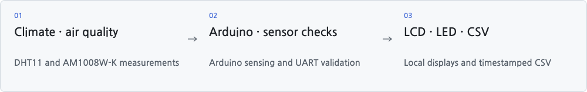
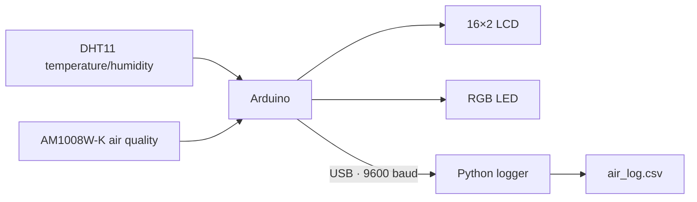

<a name="-indoor-air-monitor-project"></a>
<!-- readme-header32:start -->
<a name="indoor-air-monitor-project"></a>
<p align="center"></p>
<h1 align="center" id="project-title">Indoor Air Monitor Project</h1>
<p align="center">From sensor measurements to displays and records</p>
<p align="center">
  <a href="../README.md"></a>
  <a href="README.md"></a>
</p>
<p align="center">
  <a href="../docs/읽기안내/레벨1.md"></a>
  <a href="../docs/읽기안내/레벨2.md"></a>
  <a href="../docs/읽기안내/레벨3.md"></a>
  <a href="../docs/읽기안내/레벨4.md"></a>
  <a href="../docs/읽기안내/레벨5.md"></a>
</p>
<p align="center"><small>LEVEL links open the Korean source at the same reading level.</small></p>
<picture>
  <source media="(max-width: 600px) and (prefers-color-scheme: dark)" srcset="../assets/readme/flow-en-dark-mobile.svg" />
  <source media="(max-width: 600px)" srcset="../assets/readme/flow-en-light-mobile.svg" />
  <source media="(prefers-color-scheme: dark)" srcset="../assets/readme/flow-en-dark.svg" />
  <source media="(prefers-color-scheme: light)" srcset="../assets/readme/flow-en-light.svg" />
  
</picture>
<!-- readme-header32:end -->


An Arduino-based indoor air-quality measurement and PC logging project.

<!-- project-levels:start -->
## Choose a reading level

| Level | What this guide covers |
| --- | --- |
| [LEVEL 1 - Beginner (Korean source)](../docs/읽기안내/레벨1.md) | Unfamiliar terms, actual behavior, examples, and common misunderstandings. |
| [LEVEL 2 - Explorer (Korean source)](../docs/읽기안내/레벨2.md) | Connections between inputs, processing, outputs, features, and revision changes. |
| [LEVEL 3 - Practitioner (Korean source)](../docs/읽기안내/레벨3.md) | Prerequisites, usage steps, settings, results, and failure checks. |
| [LEVEL 4 - Advanced (Korean source)](../docs/읽기안내/레벨4.md) | Module design, state transitions, validation boundaries, and implementation choices. |
| [LEVEL 5 - Expert (Korean source)](../docs/읽기안내/레벨5.md) | Actual code, protocols, settings, full comparisons, and measurement evidence. |

Every guide covers the same project and all revisions. The existing detailed content is preserved below.
<!-- project-levels:end -->


**Technical field:** Embedded systems and IoT › Sensor communication › I²C, UART, display, and CSV

`Arduino`
`Python`
`CSV`
`PBL`

[Quick start](#quick-start) · [Hardware connections](#hardware) · [Data](#data-settings)

[Core components](#input-processing-output)

<a name="implementation-details"></a>

<a name="-센서-프레임에서-csv-한-행까지"></a>
## From a sensor frame to a CSV row

Arduino reads the DHT11 and AM1008W-K and outputs readings to the LCD, RGB LED, and serial connection. On the PC, `pc_csv_logger.py` adds the reception time and saves them.

Revision 1 handles 2 values, temperature and humidity. The final version handles 7 readings: DHT temperature/humidity, AM temperature/humidity, CO₂, VOC, and PM2.5. The final CSV has 8 columns with timestamp first and is saved separately as air_log.csv.

The final `readAM1008W` checks header 0x16, length, and the XOR checksum of the 25-byte response from address 0x28.

It shares the I²C bus with the 0x27·16×2 LCD. DHT uses pin 2; RGB uses pins 9/10/11.

The display cycles through DHT → AM temperature/humidity → air quality for 3 seconds each. Padding to 16 characters clears stale text.

The LED displays the worst grade among successfully read sensors and turns off if all reads fail.

- Reception checks: PC `parse_line` requires 7 comma-separated fields, each numeric or blank, with at least one value. Headers, invalid column counts, and all-empty rows are not saved; partial failures remain blank.
- Connection and saving: Defaults are COM4·9600 baud·2-second timeout. Logging begins after a 2-second wait and buffer reset. UTF-8 append mode writes a header only for an empty file and flushes every row.
- Shutdown and limitations: After Ctrl+C, finally closes the port. Automatic port reconnection is not implemented.

Before use, check sensor wiring, board, DHT/LCD libraries, pyserial, and the actual PORT. Do not let the serial monitor and PC logger hold the same port simultaneously.

Using a separate OUTPUT_FILE for a new measurement preserves previous records.

PC reception time is not the sensor's own time. The saved example CSV should not be interpreted as measurements from a new location.

All grade boundaries and error-handling functions are linked in the final-revision description.

[Code, conditions, observations, and full comparisons for every revision (Korean source)](../docs/REVISION_INDEX.md)


## DMF application materials

These separate practice materials apply data-management concepts from [DMF](https://github.com/leecursion/DMF) while preserving the existing sensor measurements and CSV records.

They use an external DMF checkout, so that source is not included in this repository.

This does not represent new sensor measurements or an official DMF release. Read the application report as [HTML](../DMF%20적용/1차/실행결과/DMF_적용보고서.html), [PDF](../DMF%20적용/1차/실행결과/DMF_적용보고서.pdf), or [Markdown (Korean source)](../DMF%20적용/1차/실행결과/DMF_적용보고서.md). The [final submission archive](../DMF%20적용/최종/ICT%20안전%20PBL_DMF%20적용_제출자료.zip) is also available.

| Input | Processing | Supporting materials |
| --- | --- | --- |
| Existing sensor code and measurement CSV | Check original hashes, versions, restrictions, and audit history | [DMF application Revision 1 (Korean source)](../docs/revisions/dmf-1.md) · [Material folder](../DMF%20적용/1차) · [Full comparison](../docs/revisions/dmf-1.patch) |

<a name="️-차수와-자료-둘러보기"></a>
## Browse revisions and materials

[**All revisions and file changes →** (Korean source)](../docs/REVISION_INDEX.md)

| Revision or material | Materials |
| --- | --- |
| Revision 1 | Folder/original: [Material folder](../%EC%BD%94%EB%93%9C/1%EC%B0%A8)<br>Description: [Details (Korean source)](../docs/revisions/step-1.md)<br>Previous comparison/scope: [Full comparison and scope](../docs/revisions/step-1.patch) |
| Final | Folder/original: [Material folder](../%EC%BD%94%EB%93%9C/%EC%B5%9C%EC%A2%85)<br>Description: [Details (Korean source)](../docs/revisions/step-2.md)<br>Previous comparison/scope: [Full comparison and scope](../docs/revisions/step-2.patch) |
| DMF application Revision 1 | [Material folder](../DMF%20적용/1차) · **Details:** [Description (Korean source)](../docs/revisions/dmf-1.md) · Comparison: [Full comparison](../docs/revisions/dmf-1.patch) |
| DMF application final | Revision 1 deliverable archive·[Material folder](../DMF%20적용/최종) · [Details (Korean source)](../docs/revisions/dmf-1.md) · [Full comparison](../docs/revisions/dmf-1.patch) |


<a name="overview"></a>

<a name="‍-제가-구현한-부분"></a>
## My implementation

I wrote DHT11/AM1008W-K sensor collection, LCD/RGB LED display, Arduino serial output, and the Python CSV logger. This repository organizes my sensor/logging code and measurement materials.

<a name="-주요-개발-내용"></a>
## Main development work

Adding AM1008W-K provides seven sensor values, three LCD screens, and a combined RGB grade.

The final logger includes format checks and timestamps. Prepare the sensors, wiring, and libraries before execution.

- AM1008W temperature/humidity, CO₂, VOC, and PM2.5 supplement DHT readings, with a cycling LCD and combined sensor risk grades.
- parse_line checks whether all seven fields are numbers or blank. Partial sensor failures remain blank; all-empty rows are excluded.
- The default port changes to COM4, and air_log.csv uses UTF-8. PC reception time is prepended, yielding eight columns.

**Materials:** [Revision 1 (Korean source)](../docs/versions/first.md) · [Final (Korean source)](../docs/versions/latest.md) · [Complete history (Korean source)](../docs/VERSIONS.md)

<a name="preview"></a>

<a name="input-processing-output"></a>

<a name="-입력처리출력"></a>
## Input, processing, and output

| Stage | What this project covers |
| --- | --- |
| Input | DHT11 and AM1008W-K measurements |
| Processing | Arduino I²C sensing, LCD/LED display, and UART reception checks |
| Output | Measurement screens, RGB indication, and timestamped CSV |


---

<a name="introduction"></a>

<a name="-프로젝트-소개"></a>
## Project overview

The project displays sensor readings as text and light and records them on a PC.

Arduino reads DHT11 and AM1008W-K measurements to monitor indoor conditions. A 16×2 LCD cycles through three screens, while the RGB LED shows the worst risk grade among the items read successfully.

On the PC, a Python program receives serial data and saves it to CSV with the reception time.

<a name="-프로젝트-연계와-담당-범위"></a>
### Related project and my contribution

This code organizes the portion written directly by 곽윤석 (Kwak Yunsuk) while participating in the [ICT-IndoorAD indoor-environment project](https://github.com/ICT-IndoorAD). It preserves Arduino sensor measurement, LCD/RGB LED control, and Python serial/CSV logging code by revision.

- [ICT-IndoorAD project](https://github.com/ICT-IndoorAD): The collaborative project and individual participants' repositories.
- [My ICT-IndoorAD contribution repository](https://github.com/ICT-IndoorAD/Yunsuk-Kwak): The code I wrote within that project.

Descriptions and implementation in this repository are limited to that personal contribution. See each participant's repository for other parts of the collaborative project.

| Feature | Behavior |
| --- | --- |
| Temperature/humidity | Collect temperature and humidity separately from DHT11 and AM1008W-K |
| Air quality | Collect AM1008W-K CO₂, VOC level, and PM2.5 |
| LCD display | Switch DHT → AM temperature/humidity → air quality approximately every 3 seconds |
| LED display | Use colors for good, moderate, poor, and very poor |
| Logging | Append serial data arriving approximately every 1 second to CSV |
| Error handling | Send failed sensor fields as blanks; do not save rows where every value is blank |



<a name="repository-structure"></a>

<a name="-저장소-구성"></a>
## Repository structure

The initial temperature/humidity experiment and final code with the air-quality sensor are preserved together. Main paths:

```text
.
├── README.md
├── CHANGELOG.md
├── docs/
│   └── VERSIONS.md
└── 코드/
    ├── 1차/
    │   ├── pc_csv_logger.py
    │   └── dht_lcd_rgb_csv/
    │       └── dht_lcd_rgb_csv.ino
    └── 최종/
        ├── requirements.txt
        ├── 아두이노 코드/dht_am1008w_lcd_csv/dht_am1008w_lcd_csv.ino
        └── CSV 파이썬 코드/pc_csv_logger.py
```

- [Arduino sketch](../코드/최종/아두이노%20코드/dht_am1008w_lcd_csv/dht_am1008w_lcd_csv.ino): Sensor reading, LCD display, LED grading, and CSV transmission.
- [Python logger](../코드/최종/CSV%20파이썬%20코드/pc_csv_logger.py): Format checking and CSV saving with timestamps.
- Revision 1 `dht_log.csv` and final `air_log.csv` are preserved in full. See [measurement rows, columns, and times (Korean source)](../docs/DATA.md). Save new measurements under a different filename.

<a name="hardware"></a>

<a name="-하드웨어-연결"></a>
## Hardware connections

Check your board before connecting sensors. These pins are the current sketch settings; A4/A5 refer to Arduino Uno-family boards. Use your board's SDA/SCL pins on other boards.

| Component | Connection or setting |
| --- | --- |
| DHT11 | Data pin D2, `DHTTYPE = DHT11` in code |
| AM1008W-K | I²C version, SDA → A4 / SCL → A5, address `0x28` |
| 16×2 I²C LCD | SDA → A4 / SCL → A5, address `0x27` |
| RGB LED | R → D9 / G → D10 / B → D11 |
| PC | USB serial, `9600 baud` |

AM1008W-K and the LCD share the I²C bus. Match supply voltages to component specifications and use a common GND. Use appropriate current-limiting resistors for the LED. Current LED control turns on at HIGH; a common-anode LED requires inverted control logic.

<a name="quick-start"></a>

<a name="-빠른-시작"></a>
## Quick start

<a name="-1-아두이노에-스케치-업로드"></a>
### 1. Upload the Arduino sketch

1. In Arduino IDE, open `코드/최종/아두이노 코드/dht_am1008w_lcd_csv/dht_am1008w_lcd_csv.ino`.
2. Install `DHT sensor library`, its dependencies, and `LiquidCrystal_I2C`. Choose an LCD-library version supporting `init()` and `backlight()`.
3. Select the board and port, then upload.
4. Open the serial monitor at `9600 baud` to check CSV output. Close it before running Python.

For DHT22, change `DHTTYPE` to `DHT22`. If the LCD address differs, replace the address in `LiquidCrystal_I2C lcd(0x27, 16, 2)` with the actual device address.

<a name="-2-python-환경-준비"></a>
### 2. Prepare Python

Run from the repository root.

```powershell
python -m pip install -r "코드/최종/requirements.txt"
```

<a name="-3-포트-설정-및-기록-시작"></a>
### 3. Set the port and start logging

Set `PORT` in `pc_csv_logger.py` to your actual Arduino port. The default is `COM4`.

```python
PORT = "COM4"
BAUD = 9600
OUTPUT_FILE = "air_log.csv"
```

```powershell
cd "코드/최종/CSV 파이썬 코드"
python pc_csv_logger.py
```

Stop with `Ctrl+C`. The file is created in the current working directory; an existing file is appended to. To separate new measurements from previous records, choose another `OUTPUT_FILE` before running.

<a name="data-settings"></a>

<a name="-데이터-구성"></a>
## Data

CSV contains PC reception time and 7 sensor values. `timestamp` is the PC's local time without timezone information.

| Column | Meaning | Unit |
| --- | --- | --- |
| `timestamp` | Time the PC received the data | `YYYY-MM-DD HH:MM:SS` |
| `dht_temp_C` | DHT temperature | °C |
| `dht_humi_pct` | DHT relative humidity | % |
| `am_temp_C` | AM1008W-K temperature | °C |
| `am_humi_pct` | AM1008W-K relative humidity | % |
| `co2_ppm` | CO₂ | ppm |
| `voc_level` | VOC level | Sensor level value |
| `pm25_ugm3` | PM2.5 | µg/m³ |

The logger skips headers, rows with the wrong number of columns, and fields containing anything other than numbers or blanks. Rows with partial sensor failures retain valid readings. Check measurement dates, row counts, and continuity from the file you actually collected.

<a name="led-thresholds"></a>

<a name="-led-표시-기준"></a>
## LED thresholds

These are the project's grading rules implemented in the current code. Each item is evaluated and the worst grade determines the final color. The ranges below reflect code evaluation order without overlaps.

| Item | Green: good | Yellow: moderate | Red: poor | Purple: very poor |
| --- | --- | --- | --- | --- |
| Temperature (°C) | At least 20, below 26 | At least 18, below 20 / at least 26, below 28 | At least 15, below 18 / at least 28, below 30 | Below 15 / at least 30 |
| Humidity (%) | 40–60 | At least 30, below 40 / above 60, at most 70 | At least 20, below 30 / above 70, at most 80 | Below 20 / above 80 |
| CO₂ (ppm) | Below 800 | At least 800, below 1000 | At least 1000, below 1500 | At least 1500 |
| VOC level | 0–1 | 2 | At least 3 | Not applicable |
| PM2.5 (µg/m³) | At most 15 | Above 15, at most 35 | Above 35, at most 75 | Above 75 |

If all sensor reads fail, the LED turns off. This table describes code behavior; it does not define official environmental or health criteria.

<a name="troubleshooting"></a>

<a name="️-문제-해결"></a>
## Troubleshooting

| Symptom | What to check |
| --- | --- |
| Serial port cannot open | `PORT`, USB connection, and whether another program holds the port |
| No LCD text | I²C address, SDA/SCL connections, and contrast |
| `AM1008W Error` | I²C version, address `0x28`, wiring/power, frame, and checksum |
| `DHT Sensor Error` | Data pin D2, sensor type, and wiring |
| Some CSV values are blank | Whether the corresponding sensor read failed |
| Unexpected LED color | The worst grade among all readings, LED type, and wiring |

---

<div align="center">

**Measure → Display → Record**<br>
Indoor-environment sensing project

</div>


<a name="-측정-원본과-프로젝트-문서"></a>
## Original measurements and project documents

| Material | File |
| --- | --- |
| Revision 1 measurements | [dht_log.csv](../코드/1차/dht_log.csv) |
| Final measurements | [air_log.csv](../코드/최종/CSV%20파이썬%20코드/air_log.csv) |

The CSV files are the complete saved records. The interval between a file's first and last timestamp does not establish uninterrupted continuous measurement. Download large CSV files to inspect them.


[**Measurement row counts, times, and columns →** (Korean source)](../docs/DATA.md)
