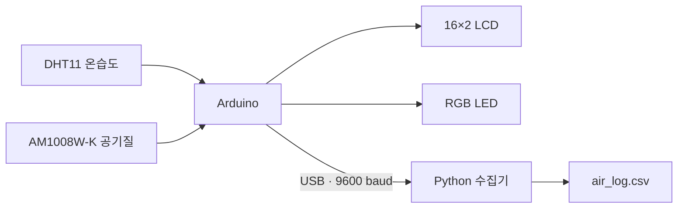

<div align="center">

# 🌿 실내 공기질 모니터링

### 수요일 PBL · Arduino × Python

온도와 습도부터 CO₂, VOC, 초미세먼지까지.<br>
센서로 측정하고, LCD와 RGB LED로 확인하고, CSV로 기록합니다.


[빠른 시작](#-빠른-시작) · [하드웨어 연결](#-하드웨어-연결) · [데이터 구성](#-데이터-구성)

</div>

---

## ✨ 프로젝트 소개

DHT11과 AM1008W-K의 측정값을 아두이노에서 읽어 실내 환경을 확인하는 프로젝트입니다. 16×2 LCD는 세 화면을 순환하며 값을 표시하고, RGB LED는 읽기에 성공한 항목 중 가장 높은 위험 등급을 색으로 보여줍니다. PC에서는 Python 프로그램이 시리얼 데이터를 받아 수신 시각과 함께 CSV에 저장합니다.

| 기능 | 동작 |
| :--- | :--- |
| 🌡️ 온습도 측정 | DHT11과 AM1008W-K에서 각각 온도·습도 수집 |
| 🍃 공기질 측정 | AM1008W-K의 CO₂, VOC 단계, PM2.5 수집 |
| 🖥️ LCD 표시 | DHT → AM 온습도 → 공기질 화면을 약 3초마다 전환 |
| 🚦 LED 표시 | 좋음·보통·나쁨·매우 나쁨을 색으로 구분 |
| 💾 데이터 기록 | 약 1초 간격의 시리얼 데이터를 CSV에 누적 저장 |
| 🧩 오류 처리 | 실패한 센서 항목은 빈칸으로 전송, 모든 값이 빈 행은 저장 제외 |



## 📁 저장소 구성

원본 최종 폴더의 세 파일을 폴더 구조 그대로 보관했습니다.

```text
.
├── README.md
├── requirements.txt
├── .gitignore
├── 아두이노 코드/
│   └── dht_am1008w_lcd_csv/
│       └── dht_am1008w_lcd_csv.ino
└── CSV 파이썬 코드/
    ├── pc_csv_logger.py
    └── air_log.csv
```

- [아두이노 스케치](아두이노%20코드/dht_am1008w_lcd_csv/dht_am1008w_lcd_csv.ino): 센서 읽기, LCD 표시, LED 등급 판정, CSV 전송.
- [Python 수집기](CSV%20파이썬%20코드/pc_csv_logger.py): 데이터 형식 검사 및 타임스탬프를 포함한 CSV 저장.
- `air_log.csv`: 수집기를 실행하면 작업 위치에 생성되는 기록 파일입니다. 이 공개 저장소에는 포함되어 있지 않습니다.

## 🔌 하드웨어 연결

아래 핀은 현재 스케치 설정입니다. A4/A5는 Arduino Uno 계열 기준이며, 다른 보드에서는 해당 보드의 SDA/SCL 핀을 사용하세요.

| 부품 | 연결 / 설정 |
| :--- | :--- |
| DHT11 | 데이터 핀 D2, 코드의 `DHTTYPE = DHT11` |
| AM1008W-K | I²C 버전, SDA → A4 / SCL → A5, 주소 `0x28` |
| 16×2 I²C LCD | SDA → A4 / SCL → A5, 주소 `0x27` |
| RGB LED | R → D9 / G → D10 / B → D11 |
| PC 연결 | USB 시리얼, `9600 baud` |

AM1008W-K와 LCD는 같은 I²C 버스를 공유합니다. 전원 전압은 각 부품 사양에 맞추고 GND를 공통으로 연결하세요. LED에는 적절한 전류 제한 저항을 사용하세요. 현재 LED 제어는 HIGH에서 켜지는 방식이므로 공통 애노드 LED는 제어 논리를 반전해야 합니다.

## 🚀 빠른 시작

### 1. 아두이노에 스케치 업로드

1. Arduino IDE에서 `아두이노 코드/dht_am1008w_lcd_csv/dht_am1008w_lcd_csv.ino`를 엽니다.
2. `DHT sensor library`와 해당 라이브러리가 요구하는 의존성, `LiquidCrystal_I2C` 라이브러리를 설치합니다. LCD 라이브러리는 `init()`와 `backlight()`를 지원하는 버전을 사용하세요.
3. 보드와 포트를 선택한 뒤 업로드합니다.
4. 시리얼 모니터를 `9600 baud`로 열어 CSV 출력 여부를 확인하고, Python 실행 전에는 시리얼 모니터를 닫습니다.

DHT22를 사용하면 `DHTTYPE`을 `DHT22`로 바꾸세요. LCD 주소가 다르면 `LiquidCrystal_I2C lcd(0x27, 16, 2)`의 주소를 실제 장치 주소로 수정하세요.

### 2. Python 환경 준비

저장소 최상위 폴더에서 실행합니다.

```powershell
python -m pip install -r requirements.txt
```

### 3. 포트 설정 및 기록 시작

`pc_csv_logger.py`의 `PORT`를 실제 아두이노 포트로 바꿉니다. 기본값은 `COM4`입니다.

```python
PORT = "COM4"
BAUD = 9600
OUTPUT_FILE = "air_log.csv"
```

```powershell
cd "CSV 파이썬 코드"
python pc_csv_logger.py
```

`Ctrl+C`로 종료합니다. 파일은 현재 작업 폴더에 생성되며, 기존 파일이 있으면 이어서 저장합니다. 제공된 원본 데이터와 새 측정을 분리하려면 실행 전에 `OUTPUT_FILE`을 다른 이름으로 지정하세요.

## 📊 데이터 구성

CSV는 PC 수신 시각과 센서 값 7개로 구성됩니다. `timestamp`는 PC의 로컬 시각이며 시간대 정보는 포함하지 않습니다.

| 열 | 의미 | 단위 |
| :--- | :--- | :--- |
| `timestamp` | PC에서 데이터를 수신한 시각 | `YYYY-MM-DD HH:MM:SS` |
| `dht_temp_C` | DHT 온도 | °C |
| `dht_humi_pct` | DHT 상대습도 | % |
| `am_temp_C` | AM1008W-K 온도 | °C |
| `am_humi_pct` | AM1008W-K 상대습도 | % |
| `co2_ppm` | CO₂ | ppm |
| `voc_level` | VOC 단계 | 센서 단계 값 |
| `pm25_ugm3` | PM2.5 | µg/m³ |

수집기는 헤더, 열 개수가 잘못된 행, 숫자 또는 빈칸 이외의 값이 있는 행을 건너뜁니다. 일부 센서가 실패한 행은 정상 항목을 보존합니다. 원본 CSV의 첫 기록은 `2026-10-03 00:29:31`, 마지막 기록은 `2026-10-14 14:44:49`입니다. 이 범위가 중단 없는 연속 측정을 의미하지는 않습니다.

## 🚦 LED 표시 기준

현재 코드에 구현된 프로젝트 판정 기준입니다. 각 항목을 평가한 뒤 가장 나쁜 등급을 최종 색으로 표시합니다. 아래 범위는 서로 겹치지 않도록 코드의 판정 순서를 반영했습니다.

| 항목 | 🟢 좋음 | 🟡 보통 | 🔴 나쁨 | 🟣 매우 나쁨 |
| :--- | :--- | :--- | :--- | :--- |
| 온도 (°C) | 20 이상 26 미만 | 18 이상 20 미만 / 26 이상 28 미만 | 15 이상 18 미만 / 28 이상 30 미만 | 15 미만 / 30 이상 |
| 습도 (%) | 40–60 | 30 이상 40 미만 / 60 초과 70 이하 | 20 이상 30 미만 / 70 초과 80 이하 | 20 미만 / 80 초과 |
| CO₂ (ppm) | 800 미만 | 800 이상 1000 미만 | 1000 이상 1500 미만 | 1500 이상 |
| VOC 단계 | 0–1 | 2 | 3 이상 | 해당 없음 |
| PM2.5 (µg/m³) | 15 이하 | 15 초과 35 이하 | 35 초과 75 이하 | 75 초과 |

모든 센서 읽기가 실패하면 LED는 꺼집니다. 이 표는 코드 동작을 설명하며 공식 환경·건강 판정 기준을 제시하는 표가 아닙니다.

## 🛠️ 문제 해결

| 증상 | 확인할 내용 |
| :--- | :--- |
| 시리얼 포트를 열 수 없음 | `PORT` 설정, USB 연결, 다른 프로그램의 포트 사용 여부 |
| LCD에 글자가 나오지 않음 | I²C 주소, SDA/SCL 연결, 대비 조절 |
| `AM1008W Error` 표시 | I²C 버전 여부, 주소 `0x28`, 배선·전원, 프레임 및 체크섬 |
| `DHT Sensor Error` 표시 | 데이터 핀 D2, 센서 종류, 배선 |
| CSV에 일부 값이 빈칸 | 해당 센서 읽기 실패 여부 |
| LED 색상이 예상과 다름 | 모든 측정 항목 중 가장 나쁜 등급, LED 종류 및 배선 |

---

<div align="center">

**측정 → 표시 → 기록**<br>
수요일 PBL 실내 환경 센싱 프로젝트

</div>
